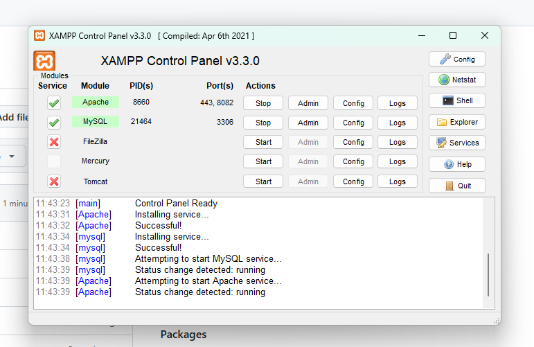
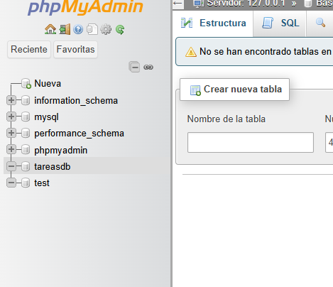

* winget install Python.Python.3.12
* py -3.12 --version

* (estoe s el git clone)
* git --version
* cd Desktop
* cd 24-09-2026
* git clone https://github.com/ericRailef/App-Tareas.git
* cd App-Tareas

* py -3.12 -m venv venv
* venv\Scripts\activate
* pip install -r requirements.txt

* abrir xampp y levantar apache y mysql
* if a http://localhost:8082/phpmyadmin/
* new database -> "tareasdb"

* python manage.py check
* python manage.py migrate
* python manage.py createsuperuser
* (benja 123123ab)
* python manage.py runserver

